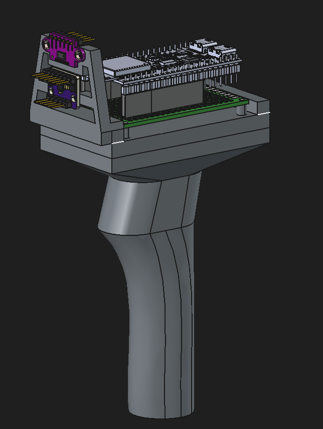

# 3DModels

Mechanical design files for the printed enclosure that houses the ESP32-S3, VL53L0X, and LSM6DS3.

## Files

| File | Description |
|------|-------------|
| `Body.FCStd` | FreeCAD source — main scanner body |
| `Body.stl` | Exported STL ready for slicing |
| `MountedPiece.stl` | Bracket/mounting piece STL |
| `CE3E3V2_Body.gcode` | G-code sliced for Creality Ender 3 E3V2 |
| `CE3E3V2_MountedPiece.gcode` | G-code for the mounting piece |
| `Body.20261022-171740.FCBak` | FreeCAD auto-backup |

## Subdirectories

| Directory | Contents |
|-----------|----------|
| `ExtraModels/` | Downloaded STEP/SolidWorks component reference models (ESP32-S3, VL53L0X, LSM6DS3, headers, PCB) — used for visual reference in FreeCAD only, not printed |

## Printing notes

- Material: PLA, 0.2 mm layer height
- The `Body` holds the sensor PCB and ESP32-S3 module with cable routing channels
- The `MountedPiece` clips onto the body and provides a grip surface

## Showcase images

