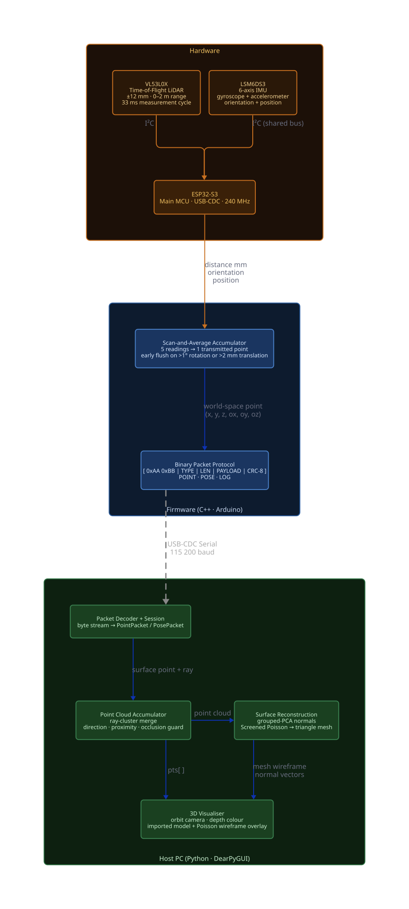
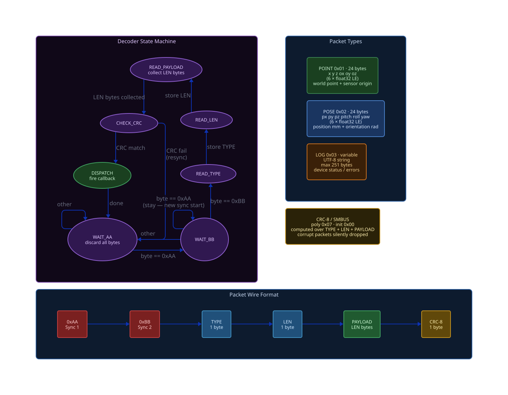

# Portable 3D Scanner

A handheld **ESP32-S3** scanner that fuses a ToF LiDAR and an IMU into a live 3D point cloud, streamed to a desktop app that reconstructs it into a mesh.

---

## Overview

The device combines a **VL53L0X** ToF LiDAR (distance) with an **LSM6DS3** IMU (orientation + position) to compute, on the microcontroller, a world-space 3D point for every reading. Points stream over USB-Serial to a **DearPyGUI** Python host, which clusters them in real time, visualises the growing cloud, and reconstructs a watertight mesh via Screened Poisson.

```
LiDAR + IMU → world-space point → USB-Serial → cluster merge → point cloud → Poisson → mesh
```

---

## Hardware

| Component | Role |
|-----------|------|
| ESP32-S3 | Main MCU, USB-CDC host link |
| VL53L0X | Time-of-Flight LiDAR — distance in mm |
| LSM6DS3 | 6-axis IMU — orientation (gyro) + position (accel) |

The sensors use the **I²C** bus, and the ESP32-S3 exposes a **USB-CDC** serial port to the host. 

The scanner is 3D printed in PLA, with a **Perfboard** for the electronics and holes to mount the LiDAR and IMU. It's designed to be ergonomic for handheld scanning.

---

## Architecture



### Firmware — `ArduinoProject/PortableScanner3D/`

```
PortableScanner3D.ino        orchestrates setup/loop + accumulator
└── src/
    ├── HAL/LiDAR/           HAL_LiDAR  — VL53L0X driver → distance (mm)
    ├── HAL/IMU/             HAL_IMU    — LSM6DS3 driver → orientation + position
    ├── Util/PointGeometry/  toWorldPoint() — spherical → Cartesian (mm)
    └── Data/
        ├── AppLayer/        encodes typed binary packets
        └── TransportLayer/  wraps Serial.write()
```

Both `_lidarOk` and `_imuOk` are tracked independently — the firmware degrades gracefully if either sensor is missing, and always reports boot status (resent whenever a new USB-CDC host connects).

### Python host — `PythonProject/`

```
main.py
└── src/
    ├── transport/    non-blocking serial reader
    ├── protocol/     byte-stream → packet decoder
    ├── app/          ScanSession   — wires transport → protocol → cloud → GUI
    ├── sim/          SimSession    — same interface, synthetic data from a mesh
    ├── data/         PointCloud ray-cluster accumulator, DevicePose
    ├── processing/   normal estimation + Poisson reconstruction
    └── gui/          DearPyGUI windows, 3D viewer, controls
```

`MainWindow._active_session` points at whichever backend (real or simulated) is currently running; all GUI callbacks read it directly rather than checking both backends, since both can hold live callbacks simultaneously.

---

## Communication protocol



```
[ 0xAA 0xBB ] [ TYPE : 1B ] [ LEN : 1B ] [ PAYLOAD : LEN B ] [ CRC8 : 1B ]
```

CRC-8/SMBUS (poly `0x07`, init `0x00`) over `TYPE + LEN + PAYLOAD`. All multi-byte fields are little-endian IEEE-754 floats.

| Type | ID | Payload | Contents |
|------|----|---------|----------|
| POINT | `0x01` | 24 B | `x y z` surface point (mm) + `ox oy oz` sensor origin (mm) |
| POSE | `0x02` | 24 B | `px py pz` position (mm) + `pitch roll yaw` (rad) |
| LOG | `0x03` | ≤251 B | UTF-8 status text |

The sensor origin in a POINT packet is captured at the **start** of the accumulation window, not at transmission — the host uses it to recover the measurement ray `normalize(point − origin)`.

---

### Scan-and-average accumulator (firmware)

A single LiDAR sample is noisy, and USB-Serial bandwidth is a shared resource. The firmware accumulates `ACC_N = 5` consecutive readings and transmits their mean as one point — ~5× less traffic, noise averaged out.

If the IMU detects **>1° rotation** or **>2 mm translation** before the buffer fills, the partial average is flushed immediately and a new window opens. Fast sweeps stay sharp; slow or static dwelling still gets the full 5-sample averaging.

### Ray-based cluster merging (host)

Re-scanning the same spot from a handheld device produces a flood of near-duplicate points. Each incoming point defines a measurement ray (sensor origin → surface point); a new point folds into an existing cluster's running mean only if **all three** hold:

- sensor lies within **5 mm** of the cluster's ray *line* (cylinder, not sphere — free to approach/retreat along the same ray)
- ray direction agrees within **1.15°**
- new surface point lands within **15 mm** of the cluster centroid (occlusion guard — stops a later, closer surface from merging into an older one)

This keeps cloud size bounded during long scans and sharpens accuracy on revisited surfaces instead of just accumulating noise. Without IMU, origin is always `(0,0,0)` and merging is disabled.

### Grouped-PCA normal estimation (host)

Poisson reconstruction needs real surface normals, not just ray directions — a single ray says nothing about local surface shape. For each cluster:

1. inherit the negated ray direction as an orientation **hint**,
2. gather neighbours within a search radius, keeping only those whose ray direction agrees within `dir_filter_deg` (so an unrelated or differently-angled surface patch doesn't get mixed in),
3. fit a plane to that filtered neighbourhood via **PCA** — the covariance matrix's smallest eigenvector is the direction of least variance, i.e. the surface normal,
4. flip the (sign-less) PCA normal to agree with the ray hint.

### Custom 3D viewer (host)

DearPyGUI has no real 3D scene renderer — only a 2D/3D scatter plot whose equal-aspect auto-fit constantly rescales the axes, fighting any manual orbit/pan/zoom. The viewer instead implements its own perspective camera (azimuth/elevation/distance around a focus point, projected by hand) on top of a plain 2D plot, with axis limits pinned every frame so the auto-fit never overrides the camera.

---

## Surface reconstruction

The **Generate** button runs Screened Poisson Surface Reconstruction over the current cloud:

| Step | Purpose |
|------|---------|
| Voxel downsample (0.5% bbox diagonal) | collapse redundant overlapping clusters |
| Statistical outlier removal (2σ, 20 neighbours) | discard stray measurements |
| Grouped-PCA normals | real surface normals, see above |
| Poisson solve | auto-scaled depth, see below |
| Laplacian smoothing (5 iters) | remove residual noise |

Depth is picked from the cleaned point count (`clip(⌊log₂(n/10)⌋, 5, 7)`) so sparse scans get a coarser, cleaner surface instead of noisy high-frequency geometry:

| Cleaned points | Depth |
|-----------------|-------|
| < 640 | 5 |
| 640 – 1 279 | 6 |
| ≥ 1 280 | 7 |

Output is a watertight mesh, exportable to STL.

---

## Python application

Real-time viewer + reconstructor, built with DearPyGUI. Run:

```bash
nix-shell shell.nix        # Python 3.12 venv, deps installed on first run
cd PythonProject && python3 main.py
```

**3D viewer** — orbit (left-drag), pan (Shift+left-drag), zoom (scroll), depth-coloured points (blue far → red near), ground grid ±500 mm, hover annotation.

**Toolbar** — connect/disconnect device or simulator, point/sensor status, Reset Reference, Save PLY, **Generate** mesh (+ Auto every 5 s), **→ STL**.

**Reconstruction window** — grouped-PCA parameters, normal preview, Poisson depth/smoothing controls.

**Simulator** — load an STL/OBJ, ray-cast synthetic scans against it with configurable noise, manual or auto-orbit device control, up to 500× fast-forward.

---

## Getting started

### Firmware

```bash
nix-shell shell.nix   # opens Arduino IDE in an FHS environment
```

Install **VL53L0X** (Pololu) and **Arduino_LSM6DS3** via Library Manager. Target board **ESP32-S3**, with **Tools → USB CDC On Boot → Enabled**.

### Python app

`open3d` requires **Python 3.12** (no 3.13 wheel yet) — use 3.12 whichever path you take below.

**NixOS** — the dev shell pins Python 3.12 and installs everything automatically:

```bash
cd Portable_3D_Scanner
nix-shell shell.nix
cd PythonProject && python3 main.py
```

**Linux / macOS (plain venv):**

```bash
cd PythonProject
python3.12 -m venv .venv
source .venv/bin/activate
pip install -r requirements.txt
python3 main.py
```

**Windows (PowerShell):**

```powershell
cd PythonProject
py -3.12 -m venv .venv
.venv\Scripts\Activate.ps1
pip install -r requirements.txt
python main.py
```

### Building a standalone executable

`requirements-dev.txt` adds **PyInstaller** on top of the runtime dependencies — install it inside the venv above, then build:

```bash
pip install -r requirements-dev.txt
pyinstaller --onefile --windowed --name PortableScanner3D --collect-all dearpygui main.py
```

The binary is written to `dist/` (`PortableScanner3D` on Linux/macOS, `PortableScanner3D.exe` on Windows). `--collect-all dearpygui` pulls in DearPyGUI's bundled native libraries and fonts, which PyInstaller's static analysis can't discover on its own.

### Report

```bash
cd docs/report && latexmk -pdf paper.tex
```

---

## Releases

Pushing a tag starting with `v` (e.g. `v1.0.0`) triggers [`.github/workflows/release.yml`](.github/workflows/release.yml): it builds the PyInstaller executable on both `ubuntu-latest` and `windows-latest`, then publishes a GitHub Release with both binaries attached.

```bash
git tag v1.0.0
git push origin v1.0.0
```

---

## Repository layout

```
Portable_3D_Scanner/
├── 3DModels/                 FreeCAD source, STL, G-code for the printed enclosure
├── docs/
│   ├── datasheets/           VL53L0X and ESP32-S3 datasheets
│   ├── diagrams/             D2 architecture diagrams (source + rendered SVG)
│   └── report/                LaTeX thesis source
├── ArduinoProject/
│   └── PortableScanner3D/    firmware sketch + layered src/
├── PythonProject/
│   ├── main.py
│   └── src/                  see Architecture above
├── shell.nix                 Nix dev shell (Arduino IDE + Python 3.12 venv)
└── README.md
```

Each directory carries its own `README.md` with per-file detail.
